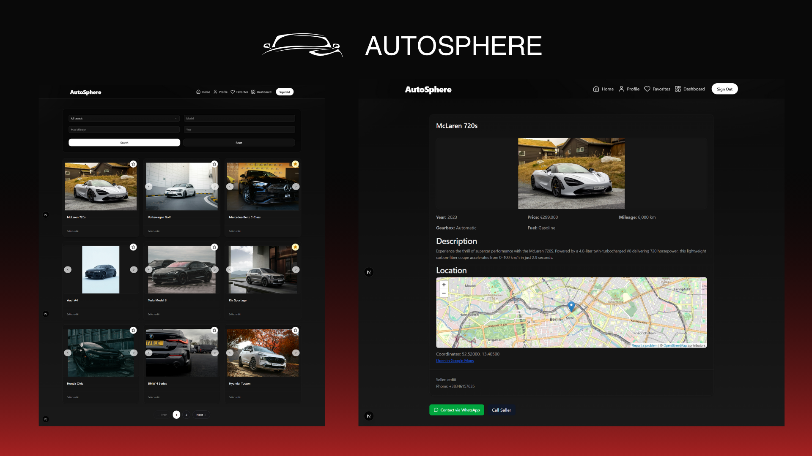

# AutoSphere

A car marketplace where people list vehicles for sale, browse and filter listings, save favorites and contact sellers directly by phone or WhatsApp.



[Demo video](https://drive.google.com/file/d/1EIkYStuFNxvfidNXHs0f7BdWaMtaf4JQ/view?usp=drive_link)

## Features

- **Listings.** Create and edit listings with brand, model, year, price, mileage, gearbox, fuel type, description and an exact map location.
- **Image galleries.** Upload several photos per car to Supabase Storage. They are shown in a responsive carousel.
- **Search and filters.** Filter the home feed by brand, model, year and mileage. Results are cached with TanStack Query, so moving between pages is instant.
- **Favorites.** Save cars and come back to them on a dedicated page.
- **Seller dashboard.** A paginated view of your own listings with edit and delete.
- **Listing details.** Photo carousel, full specifications, an embedded OpenStreetMap view and one-tap call or WhatsApp buttons.
- **Profile.** Phone numbers are stored in E.164 format, and profile changes can be applied to all of your listings at once.
- **Accounts.** Supabase Auth with sign-up, sign-in and password reset.

## Tech stack

| Layer         | Technology                                          |
| ------------- | --------------------------------------------------- |
| Framework     | Next.js 15 (App Router), React 19, TypeScript       |
| Styling       | Tailwind CSS 4, shadcn/ui, Radix UI, lucide-react   |
| Data fetching | TanStack Query 5                                    |
| Backend       | Supabase (PostgreSQL, Auth, Storage)                |
| Maps          | OpenStreetMap embeds                                |

## Project structure

```
app/
  (pages)/        Routes: cars/[id], dashboard, favorites, profile, auth pages
  page.tsx        Home feed with filters
components/
  component/      Feature components (CarCard, CarImageCarousel, CardFormModal, Navbar)
  ui/             shadcn/ui primitives
context/          Auth context
utils/supabase/   Browser, server and middleware Supabase clients
supabase/         Database schema
```

## Getting started

### Prerequisites

- Node.js 18 or later
- A Supabase project

### Setup

1. Install dependencies.

   ```bash
   npm install
   ```

2. Create the database tables by running [`supabase/schema.sql`](supabase/schema.sql) in the Supabase SQL editor.

3. In Supabase Storage, create a bucket named `car-images` and make it publicly readable.

4. Copy `.env.example` to `.env.local` and fill in your project values.

   ```bash
   cp .env.example .env.local
   ```

   | Variable                        | Description                   |
   | ------------------------------- | ----------------------------- |
   | `NEXT_PUBLIC_SUPABASE_URL`      | Supabase project URL          |
   | `NEXT_PUBLIC_SUPABASE_ANON_KEY` | Supabase anonymous public key |

5. Start the development server and open http://localhost:3000.

   ```bash
   npm run dev
   ```

### Scripts

| Command         | Description                   |
| --------------- | ----------------------------- |
| `npm run dev`   | Start the development server  |
| `npm run build` | Create a production build     |
| `npm start`     | Serve the production build    |
| `npm run lint`  | Run ESLint                    |

## Troubleshooting

- **Call or WhatsApp buttons do nothing.** The seller's phone number must be in E.164 format (a `+` followed by 8 to 15 digits).
- **The map is missing.** The listing has no `location_lat` and `location_lng` values.
- **Images do not load.** Check that the `car-images` bucket exists and is publicly readable.

## License

Copyright (c) 2025 Erdi Latifi.

This project is source-available under the [PolyForm Noncommercial License 1.0.0](LICENSE). You may use, study and modify it for personal, educational and other noncommercial purposes. Commercial use is not permitted without written permission from the author.
